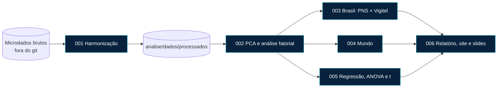

<p align="center">
  <picture>
    <source media="(prefers-color-scheme: dark)" srcset="site/assets/eseg-branco.svg">
    
  </picture>
</p>

<h1 align="center">Insônia digital</h1>

<p align="center">
  Associação entre uso de telas e sono em adultos no Brasil (PNS 2019 e Vigitel 2024), comparada com outros<br>
  quatro países e com a literatura, a partir de microdados abertos. Trabalho de Estatística 4 da Faculdade ESEG.
</p>

<p align="center">
  <a href="https://otavio44585.github.io/Estatistica-4/"></a>
  
  
  
  
  <a href="specs/README.md"></a>
</p>

---

## Ver online

**https://otavio44585.github.io/Estatistica-4/** (abre a visão geral)

| Página | Online | No repositório |
|---|---|---|
| Visão geral e conclusões | [abrir](https://otavio44585.github.io/Estatistica-4/site/index.html) | [`site/index.html`](site/index.html) |
| Apresentação (slides) | [abrir](https://otavio44585.github.io/Estatistica-4/site/apresentacao.html) | [`site/apresentacao.html`](site/apresentacao.html) |
| Apresentação em PDF (18 slides) | [abrir](https://otavio44585.github.io/Estatistica-4/site/apresentacao.pdf) | [`site/apresentacao.pdf`](site/apresentacao.pdf) |
| Roteiro da apresentação | [abrir](https://otavio44585.github.io/Estatistica-4/site/roteiro.html) | [`site/roteiro.html`](site/roteiro.html) |
| Verificação independente | [abrir](https://otavio44585.github.io/Estatistica-4/site/verificacao.html) | [`site/verificacao.html`](site/verificacao.html) |
| Etapas: dados, PCA e AF, Brasil (PNS × Vigitel), mundo, regressão, figuras-síntese | [001](https://otavio44585.github.io/Estatistica-4/site/001.html) · [002](https://otavio44585.github.io/Estatistica-4/site/002.html) · [003](https://otavio44585.github.io/Estatistica-4/site/003.html) · [004](https://otavio44585.github.io/Estatistica-4/site/004.html) · [005](https://otavio44585.github.io/Estatistica-4/site/005.html) · [006](https://otavio44585.github.io/Estatistica-4/site/006.html) | `site/001.html` … `site/006.html` |

As páginas são arquivos HTML autocontidos (estilo, figuras e logo embutidos): também abrem direto no navegador, sem internet, depois de baixar o repositório.

> [!NOTE]
> O endereço só funciona depois que o **dono do repositório** ativar o GitHub Pages (quem só tem permissão de escrita não vê essa opção):
> **Settings → Pages → Build and deployment → Source: _Deploy from a branch_ → Branch: `main`, pasta `/ (root)` → Save.**
> Em um ou dois minutos o site fica no ar. O `index.html` da raiz leva para `site/index.html`, e o `.nojekyll` faz o GitHub servir os arquivos como estão.

## Resultados em 1 minuto

> [!NOTE]
> **Os EUA saíram do trabalho em 2026-11-27.** A única base americana (NHANES 2005-06) é de antes do smartphone e não ajuda a responder a pergunta. A decisão do grupo veio depois de ver os resultados e está registrada no Histórico das specs 001 a 006.

1. **A associação aparece nas duas pesquisas brasileiras.** Quem usa computador, tablet ou celular 3 h ou mais por dia no lazer (contra menos de 1 h) relata mais problema de sono: razão de prevalências ajustada de {{rp_digital_vigitel2024}} (IC 95% {{rp_digital_vigitel2024_ic}}; p Holm {{rp_digital_vigitel2024_pholm}}) no Vigitel 2024 e {{rp_digital_pns2019}} ({{rp_digital_pns2019_ic}}; p Holm {{rp_digital_pns2019_pholm}}) na PNS 2019.
2. **PNS e Vigitel concordam.** Não foi detectada diferença entre as duas pesquisas: a razão entre as razões de prevalência é {{h39_razao}} (IC 95% {{h39_ic}}; p Holm {{h39_pholm}}). Não detectar diferença não prova que sejam iguais, e as perguntas de sono são diferentes.
3. **O efeito é pequeno.** A tela explica {{r2u_vigitel2024_tela}} da variação do índice de insônia no Vigitel e {{r2u_pns2019_tela}} na PNS: menos que o sexo ({{r2u_vigitel2024_sexo}} e {{r2u_pns2019_sexo}}) e, na PNS, menos que a idade ({{r2u_pns2019_idade}}).
4. **A idade confunde.** Sem ajuste, a PNS mostra o contrário (RP bruta {{rp_bruta_digital_pns2019}}): {{pns_tela3h_18_29}} dos adultos de 18 a 29 anos usam tela 3 h ou mais, contra {{pns_tela3h_60mais}} dos de 60 ou mais, e os jovens relatam menos problema de sono. Ajustada por idade, sexo e escolaridade, a RP vai a {{rp_ajustada_digital_pns2019}}.
5. **O Brasil no mundo.** As duas pesquisas brasileiras combinadas dão correlação ρ = {{meta_rho_brasil}}; China, Argentina, Turquia e Japão, ρ = {{meta_rho_resto}}. Não foi detectada diferença (exploratório, p = {{brasil_resto_p}}). Com tempo total de tela, a correlação (ρ = {{meta_rho_total}}) fica bem abaixo da meta-análise de referência (r = 0,28); uso problemático (ρ = {{meta_rho_problematico}}) e celular antes de dormir (ρ = {{meta_rho_presono}}) se associam mais.
6. **O índice de insônia do Vigitel mede uma coisa só.** Os três sintomas formam um único fator ({{var_pc1_insonia3_vigitel}} da variância na primeira componente; α = {{alfa_insonia3_vigitel}}), e a soma 0–12 resume o fator (r = {{r_soma_pc1_insonia3_vigitel}}).

> [!IMPORTANT]
> **Associação, não causa.** Os dados são transversais, e a literatura descreve também o caminho inverso: quem não dorme pega o celular. Nada aqui permite dizer que a tela causa insônia.

Texto completo, com métodos, limitações e referências: [`docs/relatorio.md`](docs/relatorio.md) (ou a [visão geral online](https://otavio44585.github.io/Estatistica-4/site/index.html)).

## Como reproduzir

Os microdados brutos não ficam no repositório (público; licença do Vigitel não declarada; arquivo da PNS de 455 MB). Baixe as bases listadas em [`docs/inventario-dados.md`](docs/inventario-dados.md) numa pasta e aponte a variável `STAT4_BRUTOS` para ela.

```bash
pip install -r requirements.txt
export STAT4_BRUTOS=/caminho/para/pesquisa/dados   # PowerShell: $env:STAT4_BRUTOS = "..."
python -m analise.rodar_tudo                       # harmoniza, analisa, gera notebooks, relatório, README e páginas
python -m pytest
```

| Comando | O que faz |
|---|---|
| `python -m analise.rodar_tudo` | Tudo, na ordem das specs, a partir dos microdados brutos |
| `python -m analise.rodar_tudo --sem-brutos` | Pula a harmonização (001) e usa os processados já existentes |
| `python -m analise.rodar_tudo --sem-excel` | Pula a automação do Excel; a conferência lê as saídas já exportadas em `resultados/005/excel_saidas/` |
| `python -m analise.relatorio.figuras_apresentacao` | Gera as figuras-síntese em `resultados/006/` (teste desenhado, decomposição do R², confundimento por idade, Brasil no mundo) |
| `python -m analise.relatorio.relatorio` | Preenche relatório, roteiro, slides e este README com os números de `resultados/` |
| `python -m analise.relatorio.gerar_site` | Gera `site/*.html` e o `index.html` da raiz |
| `python -m analise.relatorio.numeros` | Lista as chaves de números disponíveis para os modelos |

> [!WARNING]
> Sem os microdados, os testes que dependem dos dados processados aparecem como `skipped` (não como aprovados); só os testes de código rodam. A automação do Excel (`analise.regressao.roda_excel`) exige Windows com Excel; em outra máquina use `--sem-excel`.

Todo resultado próprio do relatório sai de um arquivo em `resultados/`, gerado por script. Os p-valores da regressão são conferidos de três formas: saída do Excel, fórmula no Excel e script ([`resultados/005/conferencia.csv`](resultados/005/conferencia.csv)): {{conf_dentro}} de {{conf_n}} comparações dentro da tolerância, e {{conf_excecoes}} exceções documentadas.

## Estrutura

| Pasta | Conteúdo |
|---|---|
| `specs/` | Planejamento por SDD: princípios (`constitution.md`) e uma pasta por etapa com especificação, plano e tarefas. Começar por [`specs/README.md`](specs/README.md) |
| `analise/` | Código: harmonização das bases (`harmonizacao/`), PCA e análise fatorial (`multivariada/`), as duas pesquisas brasileiras (`brasil_eua/`, nome mantido para não quebrar links), comparação mundial (`mundial/`), regressão linear (`regressao/`), relatório, figuras-síntese e páginas (`relatorio/`) |
| `analise/notebooks/` | Um notebook por etapa, já executado, com a narrativa de cada técnica |
| `resultados/` | Tabelas (CSV com `;` e vírgula decimal) e figuras geradas pelos scripts; `RESUMO.md` por etapa |
| `docs/` | Estado da arte, inventários, explicações didáticas (`docs/explicacoes/`), relatório e roteiro |
| `docs/modelos/` | Modelos com marcadores preenchidos pelo script: relatório, roteiro, slides e este README; `integrantes.csv` |
| `site/` | Páginas HTML da entrega, geradas por `analise/relatorio/gerar_site.py`; logos da ESEG em `site/assets/` |
| `index.html`, `.nojekyll` | Entrada do GitHub Pages: leva para `site/index.html` |
| `tests/` | Testes automáticos (`python -m pytest`) |
| `data_test_sono/` | Firmware do monitor de sono, pré-existente; fora do escopo desta análise |

## Fluxo SDD

A análise foi planejada por especificação antes da execução (Spec-Driven Development adaptado a dados). Cada etapa registra pergunta, hipóteses H0/H1, teste e α **antes** de rodar; o que surge depois sai rotulado como exploratório. Ciclo: princípios → `spec.md` → `plan.md` → `tasks.md` → código em `analise/` → números em `resultados/` → relatório. Status e regras em [`specs/README.md`](specs/README.md).



| Spec | Pergunta |
|---|---|
| [000-levantamento](specs/000-levantamento/spec.md) | Qual é o estado da arte e que dados abertos existem? |
| [001-dados-harmonizados](specs/001-dados-harmonizados/spec.md) | Dá para medir tela e sono de forma comparável entre as bases? |
| [002-estrutura-latente](specs/002-estrutura-latente/spec.md) | Que construtos os itens medem, e quantas dimensões cada escala tem? (PCA e AF) |
| [003-brasil-eua](specs/003-brasil-eua/spec.md) | Brasil: tela e sono nas duas pesquisas nacionais (PNS 2019 e Vigitel 2024). Quem usa mais tela relata mais problema de sono, e as duas pesquisas concordam? |
| [004-comparacao-mundial](specs/004-comparacao-mundial/spec.md) | Onde o Brasil se posiciona frente a outros países (China, Argentina, Turquia, Japão) e à literatura? |
| [005-regressao-linear](specs/005-regressao-linear/spec.md) | Quanto o sono varia com a tela, com covariáveis fixas? (regressão, ANOVA, t, conferência dos p-valores) |
| [006-entrega](specs/006-entrega/spec.md) | Relatório, apresentação, figuras-síntese e reprodutibilidade |

## Fontes dos dados

| Base | País | n analisado | Fonte | Acesso |
|---|---|---|---|---|
| PNS 2019 | Brasil | {{n_pns2019}} | [IBGE, microdados](https://ftp.ibge.gov.br/PNS/2019/Microdados/) | Aberto |
| Vigitel 2024 | Brasil, 27 capitais | {{n_vigitel2024}} | [Ministério da Saúde](https://svs.aids.gov.br/daent/cgdnt/vigitel/) | Aberto; licença não declarada |
| Xuzhou (SAS-SV × PSQI) | China | {{n_xuzhou}} | [PLOS ONE, material suplementar](https://doi.org/10.1371/journal.pone.0340852.s001) | CC BY 4.0 |
| Pérez-Chada (tela e sono) | Argentina | {{n_argentina}} | [Mendeley Data](https://doi.org/10.17632/pj9hzmp7ym.1) | CC BY 4.0 |
| Doomscrolling × sono | Turquia | {{n_turquia}} | [Mendeley Data](https://doi.org/10.17632/tjbkb6f25x.1) | CC BY 4.0 |
| Okajima (celular antes de dormir) | Japão | {{n_japao}} | [Zenodo](https://zenodo.org/records/20743494) | CC BY 4.0 |

Total analisado: {{n_total}} pessoas. O NHANES 2005-06 (EUA) foi usado até 2026-11-27 e retirado do trabalho (base anterior ao smartphone). Contraponto intrapessoal usado só na análise de sensibilidade: Siebers et al. (2024), Holanda, [UvA Figshare](https://doi.org/10.21942/uva.26395903.v2). Inventário completo, com as fontes descartadas e o motivo: [`docs/inventario-dados.md`](docs/inventario-dados.md).

## Princípios (resumo)

Só dado real com procedência; hipótese registrada antes do teste; p-valor sempre com tamanho de efeito e IC 95%; correção de Holm por família; peso amostral nos inquéritos; associação não é causalidade. Texto completo em [`specs/constitution.md`](specs/constitution.md).

## Integrantes

A definir em [`docs/modelos/integrantes.csv`](docs/modelos/integrantes.csv) (coluna `nome`). Depois de preencher, rode `python -m analise.relatorio.relatorio`: os nomes entram no roteiro e nos slides.

---

<sub>Este README é gerado por `analise/relatorio/relatorio.py` a partir de [`docs/modelos/README.md`](docs/modelos/README.md), com os números lidos de `resultados/` (gerado em {{data}}). Para mudar o texto, edite o modelo e rode `python -m analise.relatorio.relatorio`.</sub>
