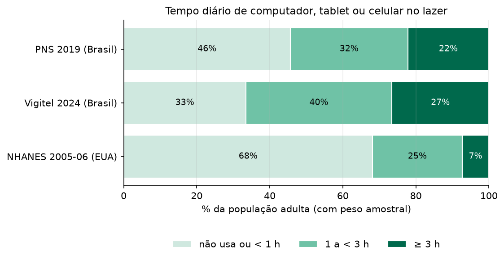
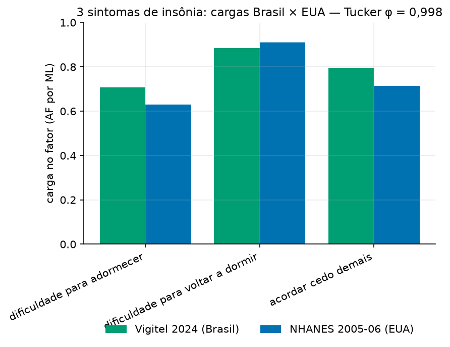
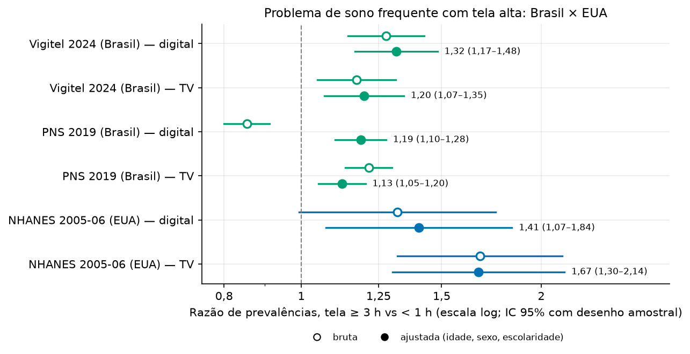
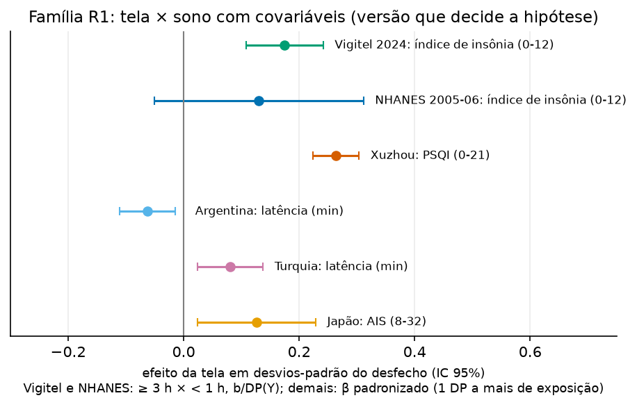
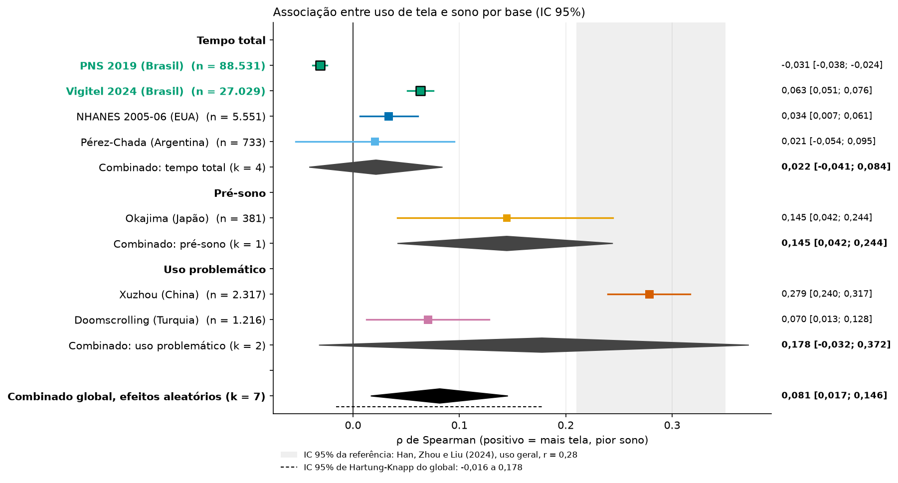

<!-- Arquivo GERADO por analise/relatorio/relatorio.py a partir de docs/modelos/relatorio.md. Edite o modelo, não este arquivo. -->

# Insônia digital: uso de telas e sono no Brasil, nos EUA e em outros quatro países

Estatística 4 · ESEG · Relatório gerado em 27/11/2026 por `analise/relatorio/relatorio.py`. Todos os resultados próprios deste texto (estimativas, IC, p, n) saem de arquivos em `resultados/` e `analise/dados/logs/`, lidos pelo script; nenhum foi digitado à mão. Números da literatura vêm das fontes citadas. Revisão do grupo pendente.

## Resumo

- **Pergunta.** Adultos que usam mais telas no lazer relatam mais problemas de sono? A associação tem o mesmo tamanho no Brasil e nos EUA, e onde o Brasil fica frente a outros países e à literatura?
- **Dados.** 125.920 pessoas em sete bases abertas: PNS 2019 e Vigitel 2024 (Brasil), NHANES 2005-06 (EUA) e amostras da China, Argentina, Turquia e Japão.
- **Mesma medida nos dois países.** Os três sintomas de insônia formam um único fator no Brasil e nos EUA, com cargas praticamente iguais (congruência de Tucker φ = 0,998). Isso autoriza comparar o índice de insônia entre os dois países.
- **Associação presente nos dois países.** Quem usa computador, tablet ou celular 3 h ou mais por dia tem prevalência de problema de sono frequente 1,32 vez a de quem usa menos de 1 h no Vigitel, 1,19 na PNS e 1,41 no NHANES. São razões de prevalência ajustadas, todas com p Holm < 0,05. No NHANES, essa conclusão depende da regra de graus de liberdade (ver §7).
- **Não foi detectada diferença entre Brasil e EUA.** A razão entre as duas razões de prevalência é 1,07 (IC 95% 0,80 a 1,44). O intervalo é largo: vai de uma associação 20% menor a 44% maior nos EUA.
- **O efeito é pequeno.** Na regressão linear do Vigitel, o tempo de tela acrescenta 0,0038 ao R², ou 0,4% da variação do índice de insônia. Na comparação mundial, a correlação com tempo total de tela é ρ = 0,022, bem abaixo da meta-análise de referência (r = 0,28). Uso problemático (0,178) e celular antes de dormir (0,145) se associam mais.
- **Idade confunde.** Sem ajuste, a PNS mostra o contrário: os que mais usam tela relatam menos problema de sono (RP bruta 0,85). Isso acontece porque os que mais usam são mais jovens. Ajustada por idade, sexo e escolaridade, a RP vai a 1,19.
- **Os dados não permitem dizer que a tela causa insônia.** São transversais, e a literatura descreve também o caminho inverso: quem não dorme pega o celular.

## 1. Pergunta e motivação

"Insônia digital" não é diagnóstico; aqui designa os problemas de sono associados ao uso de telas, sobretudo à noite. A literatura internacional é ampla, mas quase toda em crianças e adolescentes de países de alta renda. No Brasil, os estudos são locais, e os dois grandes inquéritos nacionais (PNS e Vigitel) perguntam sobre tela e sono, mas não foram analisados com essa pergunta.

O trabalho foi planejado por especificação antes da execução (`specs/`). Cada etapa registrou hipóteses, testes e critérios antes de rodar. As hipóteses da comparação Brasil × EUA foram formuladas depois de uma análise exploratória, e o texto diz isso onde elas aparecem.

## 2. O que a literatura já estabelece

- **A associação é consistente.** Em 67 estudos com crianças e adolescentes, 90% acharam associação adversa entre tela e sono (HALE; GUAN, 2015). Usar dispositivo portátil na hora de dormir se associa a sono insuficiente (OR 2,17) (CARTER et al., 2016).
- **O efeito medido em minutos é pequeno.** Cada hora de tela se associa a 3 a 8 minutos a menos de sono, e a tela explica menos de 2% da variação (PRZYBYLSKI, 2019).
- **O momento pesa mais que o total.** Checar redes sociais nos 30 minutos antes de dormir se associa a perturbação do sono independentemente do uso diário (LEVENSON et al., 2017). Cada hora de tela na cama se associa a OR 1,59 para sintomas de insônia (HJETLAND et al., 2025). No Brasil, tela por 2 h ou mais antes de deitar se associou a 17 minutos a mais de latência (CASTRO-SANTOS et al., 2023).
- **Uso problemático pesa mais que uso geral.** Na meta-análise de referência, o uso geral de mídia se correlaciona com pior qualidade de sono (r = 0,28) e o uso problemático, com mais problemas de sono (r = 0,33) (HAN; ZHOU; LIU, 2024).
- **A relação é bidirecional.** Comparando a mesma pessoa em dias diferentes, a única associação consistente é a da tela com o início mais tardio do sono (BOURKE et al., 2026). E o problema de sono também precede o uso de tela, que funciona como passatempo enquanto o sono não vem (BAUDUCCO et al., 2024).

Detalhes e as 52 referências do levantamento: `docs/estado-da-arte.md`.

## 3. Dados

| Base | País | Desenho | n | Sono | Tela |
|---|---|---|---|---|---|
| PNS 2019 | Brasil | inquérito domiciliar (peso, estrato, UPA) | 88.531 | item de sono do PHQ-9 | horas de computador/tablet/celular e de TV |
| Vigitel 2024 | Brasil, 27 capitais | inquérito telefônico (peso) | 27.048 | 3 sintomas de insônia | idem |
| NHANES 2005-06 | EUA | inquérito (peso, estrato, UPA) | 5.563 | 3 sintomas de insônia, latência | horas de computador/games e de TV |
| Xuzhou | China | universitários | 2.317 | PSQI | uso problemático de smartphone (SAS-SV) |
| Pérez-Chada | Argentina | adolescentes | 864 | latência (min) | horas de tela por dia e antes de dormir |
| Doomscrolling | Turquia | 18 a 40 anos | 1.216 | PSQI, latência | escala de doomscrolling |
| Okajima | Japão | 18 a 29 anos | 381 | escala de insônia de Atenas (AIS) | celular nas 3 h antes de dormir |

Cada base foi **harmonizada** (spec 001):

- os códigos de "não sabe" e "recusou" viraram faltantes;
- as faixas de horas foram cortadas em 1 h e 3 h nas três bases de inquérito;
- cada variável recebeu um grau de equivalência entre bases (`resultados/001/tabelas/equivalencia.csv`).

Usavam tela digital 3 h ou mais por dia, com peso amostral:

- 22% dos adultos na PNS 2019;
- 27% no Vigitel 2024;
- 7% no NHANES 2005-06, antes do smartphone.



## 4. Métodos

| Técnica | Etapa | Para quê |
|---|---|---|
| PCA por decomposição em valores singulares (Z = UΣVᵀ) | 002 | resumir os itens de cada escala e ver quantas dimensões existem |
| Análise fatorial (máxima verossimilhança, eixos principais; varimax e oblimin) | 002 | separar a variância comum da específica de cada item |
| Análise paralela de Horn, KMO, Bartlett, α de Cronbach | 002 | decidir o número de fatores e a adequação dos itens (HORN, 1965) |
| Congruência de Tucker | 002 | testar se o fator é o mesmo nos dois países (LORENZO-SEVA; TEN BERGE, 2006) |
| Regressão de Poisson com peso e variância por linearização (estrato e UPA) | 003 | razão de prevalências ajustada nos inquéritos |
| Regressão linear múltipla, ANOVA, teste t de Welch | 005 | formato da disciplina; Excel e script |
| Correlação de Spearman com z de Fisher; meta-análise de efeitos aleatórios; Q de Cochran e I² | 004 | pôr as sete bases na mesma escala e medir a heterogeneidade (FIELLER; HARTLEY; PEARSON, 1957; DERSIMONIAN; LAIRD, 1986; HIGGINS; THOMPSON, 2002) |

Regras comuns (`specs/constitution.md`):

- α = 0,05 bilateral, com correção de Holm dentro de cada família de hipóteses.
- Todo teste traz estatística, graus de liberdade, p, tamanho de efeito e IC 95%.
- Nos inquéritos, a decisão usa peso amostral e, quando a base tem, estrato e UPA.
- Estimativas brutas e ajustadas aparecem lado a lado.

## 5. Resultados

### 5.1 O índice de insônia mede a mesma coisa no Brasil e nos EUA (spec 002)

**Insônia.** Os três sintomas (dificuldade para adormecer, para voltar a dormir e acordar cedo demais) formam uma única dimensão nas duas bases. A análise paralela retém uma única componente, que explica 75% da variância no Vigitel e 71% no NHANES (α = 0,84 e 0,79). As cargas são equivalentes entre os países (Tucker φ = 0,998; o limite de equivalência é 0,95). A soma simples dos três itens correlaciona 0,9998 com a primeira componente, o que justifica usar o índice 0–12 nas etapas seguintes.

**PHQ-9.** O questionário de depressão tem 1 fator na PNS e no NHANES, com φ = 0,997. O item de sono carrega nesse fator nos dois países.

**Escalas dos outros países:**

- doomscrolling (Turquia) e insônia de Atenas (Japão): unidimensionais;
- uso problemático de smartphone (China), procrastinação do sono (Turquia) e procrastinação do sono (Japão): 2 dimensões. No Japão, a segunda é a dos itens de redação invertida.

Os escores da PCA e da análise fatorial ordenam as pessoas quase igual: correlação de 0,953 a 0,999.



### 5.2 Brasil × EUA: razões de prevalência (spec 003)

Desfecho: dificuldade para adormecer "quase sempre/sempre" no Vigitel, "often/almost always" (5 ou mais vezes por mês) no NHANES, e problema de sono em mais da metade dos dias na PNS. Exposição: tela ≥ 3 h contra < 1 h por dia. Ajuste: faixa etária, sexo e escolaridade.

| Base | Tela digital: RP (IC 95%) | p Holm | TV: RP (IC 95%) | p Holm |
|---|---|---|---|---|
| Vigitel 2024 | 1,32 (1,17 a 1,48) | < 0,001 | 1,20 (1,07 a 1,35) | 0,006 |
| PNS 2019 | 1,19 (1,10 a 1,28) | < 0,001 | 1,13 (1,05 a 1,20) | 0,003 |
| NHANES 2005-06 | 1,41 (1,07 a 1,84) | 0,033 | 1,67 (1,30 a 2,14) | 0,003 |

- **Bruta × ajustada.** A RP bruta da tela digital é 0,85 na PNS, 1,28 no Vigitel e 1,32 no NHANES. Na PNS o sinal se inverte depois do ajuste, porque os que mais usam tela são mais jovens e os jovens relatam menos problema de sono.
- **Dose-resposta.** A tendência nas 3 faixas é significativa em 5 de 6 combinações de base e exposição. A faixa de 1 a 3 h, porém, fica perto da de < 1 h: o excesso aparece em ≥ 3 h, e a relação não é uma reta.
- **Brasil × EUA.** Para tela digital, a razão NHANES ÷ Vigitel das RP é 1,07 (IC 95% 0,80 a 1,44; p Holm 1,000). Entre PNS e Vigitel também não foi detectada diferença (razão 1,11, IC 95% 0,96 a 1,28; p Holm 1,000), mas as duas usam perguntas diferentes. Nem variação por faixa etária (menor p Holm 1,000).
  - Na TV, a razão entre países é 1,42 (p = 0,012), mas cai para 1,10 (p = 0,233) sem o peso do NHANES. Essa comparação está fora da família de Holm e não é robusta.



### 5.3 Regressão linear múltipla, ANOVA e teste t (spec 005)

Mesmo formato do exercício da disciplina (SUMMARY OUTPUT do Excel), com dummies de tela (referência < 1 h) e covariáveis.

Cada hipótese aparece com duas estatísticas. A **sem peso** é a que o Excel calcula, no formato da aula. A **com peso** usa o desenho amostral e é a que decide nos inquéritos (Vigitel e NHANES). Nas bases de repositório não há desenho, e as duas coincidem.

| H | Base | Teste | Coeficiente com peso (IC 95%) | Sem peso (Excel) | Com peso (decisão) | p Holm | Decisão |
|---|---|---|---|---|---|---|---|
| H5.1 | Vigitel | t da tela ≥ 3 h; Y = índice de insônia | 0,59 (0,36 a 0,82) | t(27.022) = 9,68 | t(27.028) = 5,11 | < 0,001 | rejeita H0 |
| H5.2 | NHANES | idem | 0,42 (−0,16 a 1,00) | t(5.535) = 4,06 | t(15) = 1,54 | 0,145 | não rejeita H0 |
| H5.3 | Xuzhou | t do SAS-SV; Y = PSQI | 0,09 por ponto (0,07 a 0,10) | t(2.308) = 13,07 | igual (sem desenho amostral) | < 0,001 | rejeita H0 |
| H5.4 | Argentina | t da tela antes de dormir; Y = latência (min) | −1,32 min por hora (−2,34 a −0,30) | t(686) = −2,54 | igual (sem desenho amostral) | 0,034 | rejeita H0 |
| H5.5 | Turquia | t do doomscrolling; Y = latência (min) | 0,10 min por ponto (0,03 a 0,17) | t(1.213) = 2,81 | igual (sem desenho amostral) | 0,020 | rejeita H0 |
| H5.6 | Japão | t do celular antes de dormir; Y = AIS | 0,85 ponto por hora (0,16 a 1,54) | t(377) = 2,42 | igual (sem desenho amostral) | 0,034 | rejeita H0 |
| H5.7 | Vigitel | ANOVA de um fator, 3 faixas | — | F(2; 27.026) = 34,91 | F(2; 27.027) = 9,61 (Wald) | < 0,001 | rejeita H0 |
| H5.8 | NHANES | ANOVA de um fator, 3 faixas | — | F(2; 5.539) = 4,72 | F(2; 14) = 0,46 (Wald) | 1,000 | não rejeita H0 |
| H5.9 | Vigitel | t de Welch, ≥ 3 h × < 1 h | diferença 0,43 (0,22 a 0,64) | t(15309,2) = 6,89 (Welch) | t(15.774) = 4,00 (média ponderada) | < 0,001 | rejeita H0 |
| H5.10 | NHANES | t de Welch, ≥ 3 h × < 1 h | diferença 0,25 (−0,36 a 0,86) | t(549,2) = 3,03 (Welch) | t(15) = 0,88 (média ponderada) | 1,000 | não rejeita H0 |
| H5.11 | Vigitel + NHANES | F parcial da interação país × tela | −0,17 (−0,81 a 0,47) | F(2; 32.561) = 0,56 | F(2; 14) = 0,19 | 1,000 | não rejeita H0 |

**Pontos de leitura:**

- **O peso amostral muda as conclusões no NHANES.** Sem peso, como o Excel calcula, H5.2 teria p = < 0,001. Com o desenho amostral (só 15 estratos e 30 UPAs, 15 gl), o intervalo alarga e o p vai a 0,145. Na regra do `svyglm`, p = 0,158, e sem as observações influentes, p = 0,167; a decisão não muda.
- **Significativo não quer dizer grande.** No Vigitel, a tela acrescenta 0,0038 ao R² e a diferença de médias tem d de Cohen = 0,124. Em Xuzhou, o uso problemático acrescenta 0,068.
- **Dois resultados são frágeis:**
  - Na Argentina, o sinal é o contrário do esperado (mais tela, menos latência) e some quando a série escolar substitui a idade (p = 0,093).
  - Na Turquia, a associação some sem as observações influentes (p = 0,096).
- **Conferência dos p-valores.** A ferramenta Análise de Dados do Excel foi executada de verdade, por automação. Cada número (coeficiente, erro padrão, t, p, F, R²) foi comparado por três caminhos: saída do Excel, fórmula no Excel e script. Foram 922 comparações: 920 dentro da tolerância (diferença relativa < 1e-8) e 2 exceções documentadas. Entre fórmula e script, a maior diferença relativa foi 4,5e-10, e entre Excel e script, 4,5e-10. As exceções (diferença 1,5e-05) vêm do teste t de Welch: o Excel arredonda o grau de liberdade para inteiro, e o relatório usa o fracionário.



### 5.4 O Brasil no mundo (spec 004)

Correlação de Spearman entre exposição e escore de sono em cada base (positivo = mais tela, pior sono):

| Base | Tipo de exposição | ρ (IC 95%) |
|---|---|---|
| PNS 2019 | tempo total | −0,031 (−0,038 a −0,024) |
| Vigitel 2024 | tempo total | 0,063 (0,051 a 0,076) |
| NHANES 2005-06 | tempo total | 0,034 (0,007 a 0,061) |
| Argentina | tempo total | 0,021 (−0,054 a 0,095) |
| Japão | celular antes de dormir | 0,145 (0,042 a 0,244) |
| China (Xuzhou) | uso problemático | 0,279 (0,240 a 0,317) |
| Turquia | uso problemático (doomscrolling) | 0,070 (0,013 a 0,128) |

Resultados da meta-análise de efeitos aleatórios:

- **Estimativa global:** ρ = 0,081. Pelo IC de DerSimonian-Laird (0,017 a 0,146; p = 0,014), fica acima de zero. Pelo IC de Hartung-Knapp, mais adequado com só 7 bases (−0,016 a 0,178; p = 0,087), não se distingue de zero.
- **H4.1, heterogeneidade:** enorme e significativa (Q = 382,2, gl = 6, p < 0,001; I² = 98,4%).
- **H4.2, tipo de exposição:** a ordem é a da literatura, tempo total 0,022 < pré-sono 0,145 < uso problemático 0,178. A diferença entre os subgrupos não é significativa (Q = 5,27, p Holm 0,216), com só 1 a 4 bases por subgrupo.
- **H4.3, Brasil × outros países com tempo total:** sem diferença. O Brasil (PNS + Vigitel) tem ρ = 0,016 e os outros, 0,032 (z = −0,33, p Holm 1,000).
- **H4.4, comparação com a meta-análise de referência:** o tempo total combinado (0,022) fica fora do intervalo 0,21–0,35 de Han, Zhou e Liu (2024), e o teste de equivalência não rejeita H0 (p Holm 1,000). A associação com tempo total, nos nossos dados, é muito menor que a da literatura.
- **Desenho amostral (deff):** as correlações dos inquéritos foram calculadas sem o desenho amostral. Multiplicando a variância pelo deff de Kish (PNS 3,21, Vigitel 3,74, NHANES 1,61), a estimativa global fica 0,082 (0,003 a 0,161) e o I², 97,5%. Nenhuma decisão muda.
- **Ajuste por idade:** a PNS passa de −0,031 para 0,027, e o tempo total combinado, de 0,022 para 0,045 (0,017 a 0,073).



## 6. Discussão

**Tamanho.** A associação entre tela e problema de sono aparece nos dois países e na maioria das bases, mas é pequena. Os grandes inquéritos detectam com folga efeitos sem importância prática. Esse é o padrão descrito por Przybylski (2019): efeitos consistentes, que explicam poucos por cento da variação. As razões de prevalência entre 1,19 e 1,41 descrevem um grupo extremo (≥ 3 h) contra o de baixo uso. Por hora de tela ou por desvio-padrão, o efeito é modesto.

**Não foi detectada diferença entre Brasil e EUA.** Isso vale para a razão de prevalências (003), o coeficiente da regressão (005) e a correlação (004). Ausência de diferença detectada não é prova de igualdade: o IC de H3.6 vai de 0,80 a 1,44, porque o desenho do NHANES 2005-06 tem só 15 estratos.

A comparabilidade também é parcial:

- o desfecho é equivalente (002), mas com âncoras de frequência diferentes;
- a exposição é computador e games em 2005 contra celular em 2024;
- a congruência de Tucker mostra cargas parecidas, mas não testa invariância formal.

**O que importa é o tipo de uso.** As maiores correlações vieram do uso problemático (China) e do celular nas horas antes de dormir (Japão), não do tempo total. Isso concorda com Han, Zhou e Liu (2024), com Levenson et al. (2017) e com Hjetland et al. (2025). Mas cada subgrupo tem uma ou duas bases, e o teste não confirma a diferença.

**Confundimento.** A inversão do sinal na PNS mostra que a idade confunde a relação: jovens usam mais tela e relatam menos problema de sono. Uma comparação sem ajuste levaria à conclusão oposta.

## 7. Limitações

- **Dados transversais.** Não dá para separar "tela piora o sono" de "quem dorme mal usa mais tela" (BAUDUCCO et al., 2024).
- **NHANES 2005-06 é de antes do smartphone.** A comparação Brasil × EUA mistura país e época, e o Vigitel cobre só as capitais.
- **O item de sono da PNS é outro.** É o do PHQ-9 (inclui dormir demais) e só é comparável de forma aproximada.
- **Medidas autorrelatadas e em faixas.** Isso atenua as correlações.
- **Bases de repositório sem desenho amostral.**
  - Sexo sem rótulo em Xuzhou e no Japão.
  - Rótulo da escala da Turquia inferido, sem dicionário.
  - 163 adolescentes argentinos sem idade.
- **Graus de liberdade do NHANES.** O projeto usa gl = UPAs − estratos (15) em todas as specs. A regra do `svyglm` do R desconta os parâmetros do modelo (7 gl na H3.3). Por essa regra, a H3.3 deixaria de rejeitar H0: p Holm 0,061, contra 0,033. As demais decisões não mudam (`resultados/003/tabelas/hipoteses.csv`, colunas `*_svyglm`).
- **Tucker não é um teste formal de invariância.** A análise fatorial confirmatória multigrupo ficou fora do escopo.

## 8. Conclusões

1. Em adultos brasileiros, usar tela digital no lazer 3 h ou mais por dia se associa a uma prevalência de problema de sono 19% a 32% maior, depois de ajustar por idade, sexo e escolaridade. Não foi detectada diferença entre as duas pesquisas nacionais.
2. Nos EUA (2005-06) a associação tem a mesma direção. Não foi detectada diferença entre os países, com intervalo largo (0,80 a 1,44).
3. O efeito é pequeno: no Vigitel, o tempo de tela explica 0,4% da variação do índice de insônia.
4. Uso problemático e uso antes de dormir se associam mais ao sono que o tempo total, como diz a literatura. Com tão poucas bases, a diferença não foi confirmada.
5. Sem ajuste por idade a conclusão se inverte. Comparações entre grupos de uso de tela precisam sempre de ajuste.
6. Os dados são transversais. O resultado é uma associação; mostrar causa exigiria estudo longitudinal ou experimental.

## 9. Como conferir

```bash
export STAT4_BRUTOS=/caminho/para/pesquisa/dados
python -m analise.rodar_tudo
python -m pytest
```

Cada etapa tem:

- uma spec com as hipóteses (`specs/00N-*/spec.md`);
- um notebook executado (`analise/notebooks/`);
- um resumo (`resultados/00N/RESUMO.md`);
- uma explicação didática (`docs/explicacoes/`).

## Referências

BAUDUCCO, S. et al. A bidirectional model of sleep and technology use: A theoretical review of How much, for whom, and which mechanisms. **Sleep Medicine Reviews**, v. 76, p. 101933, 2024. DOI: https://doi.org/10.1016/j.smrv.2024.101933.

BOURKE, M. et al. Within-Person Association Between Daily Screen Use and Sleep in Youth: A Systematic Review and Meta-Analysis. **JAMA Pediatrics**, v. 180, n. 5, p. 500, 2026. DOI: https://doi.org/10.1001/jamapediatrics.2025.6490.

CARTER, B. et al. Association Between Portable Screen-Based Media Device Access or Use and Sleep Outcomes: A Systematic Review and Meta-analysis. **JAMA Pediatrics**, v. 170, n. 12, p. 1202, 2016. DOI: https://doi.org/10.1001/jamapediatrics.2016.2341.

CASTRO-SANTOS, L. et al. Sleep and circadian hygiene practices association with sleep quality among Brazilian adults. **Sleep Medicine: X**, v. 6, p. 100088, 2023. DOI: https://doi.org/10.1016/j.sleepx.2023.100088.

DERSIMONIAN, R.; LAIRD, N. Meta-analysis in clinical trials. **Controlled Clinical Trials**, v. 7, n. 3, p. 177-188, 1986. DOI: https://doi.org/10.1016/0197-2456(86)90046-2.

FIELLER, E. C.; HARTLEY, H. O.; PEARSON, E. S. Tests for rank correlation coefficients. I. **Biometrika**, v. 44, n. 3-4, p. 470-481, 1957. DOI: https://doi.org/10.1093/biomet/44.3-4.470.

HALE, L.; GUAN, S. Screen time and sleep among school-aged children and adolescents: A systematic literature review. **Sleep Medicine Reviews**, v. 21, p. 50-58, 2015. DOI: https://doi.org/10.1016/j.smrv.2014.07.007.

HAN, X.; ZHOU, E.; LIU, D. Electronic Media Use and Sleep Quality: Updated Systematic Review and Meta-Analysis. **Journal of Medical Internet Research**, v. 26, p. e48356, 2024. DOI: https://doi.org/10.2196/48356.

HIGGINS, J. P. T.; THOMPSON, S. G. Quantifying heterogeneity in a meta-analysis. **Statistics in Medicine**, v. 21, n. 11, p. 1539-1558, 2002. DOI: https://doi.org/10.1002/sim.1186.

HJETLAND, G. J. et al. How and when screens are used: comparing different screen activities and sleep in Norwegian university students. **Frontiers in Psychiatry**, v. 16, 1548273, 2025. DOI: https://doi.org/10.3389/fpsyt.2025.1548273.

HORN, J. L. A rationale and test for the number of factors in factor analysis. **Psychometrika**, v. 30, n. 2, p. 179-185, 1965. DOI: https://doi.org/10.1007/BF02289447.

LEVENSON, J. C. et al. Social Media Use Before Bed and Sleep Disturbance Among Young Adults in the United States: A Nationally Representative Study. **Sleep**, v. 40, n. 9, zsx113, 2017. DOI: https://doi.org/10.1093/sleep/zsx113.

LORENZO-SEVA, U.; TEN BERGE, J. M. F. Tucker's congruence coefficient as a meaningful index of factor similarity. **Methodology**, v. 2, n. 2, p. 57-64, 2006. DOI: https://doi.org/10.1027/1614-2241.2.2.57.

PRZYBYLSKI, A. K. Digital Screen Time and Pediatric Sleep: Evidence from a Preregistered Cohort Study. **The Journal of Pediatrics**, v. 205, p. 218-223.e1, 2019. DOI: https://doi.org/10.1016/j.jpeds.2018.09.054.
