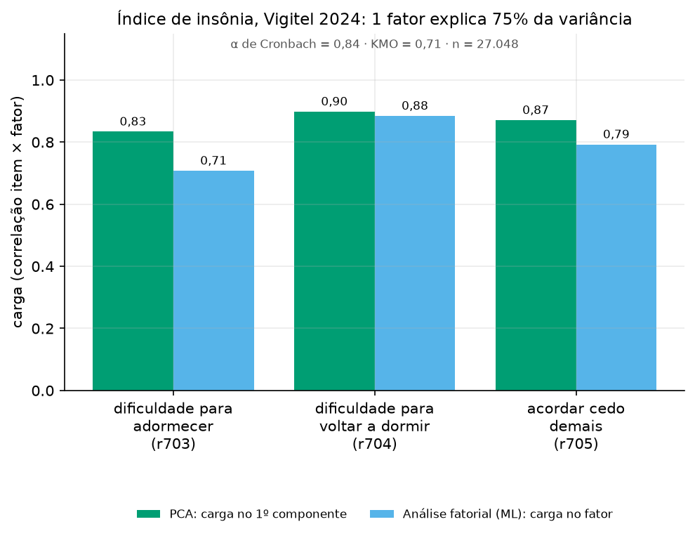
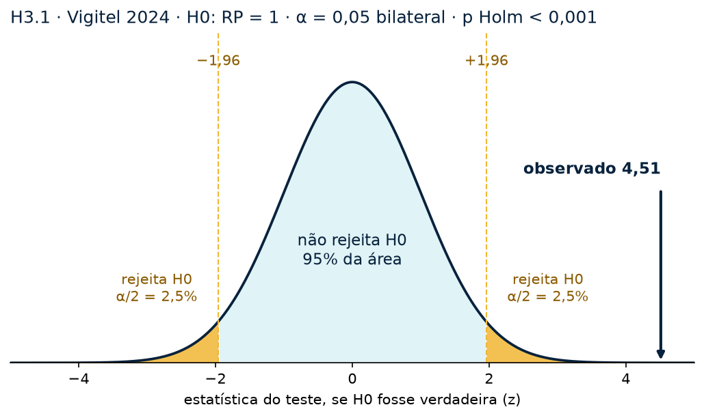
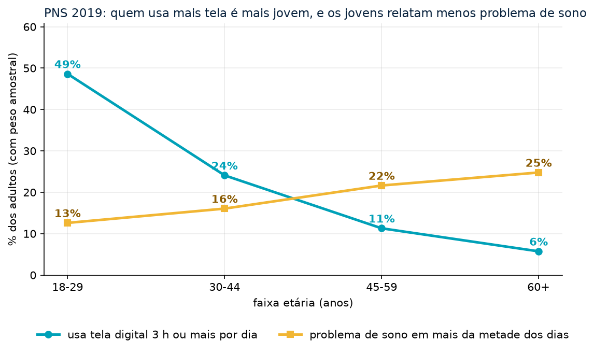
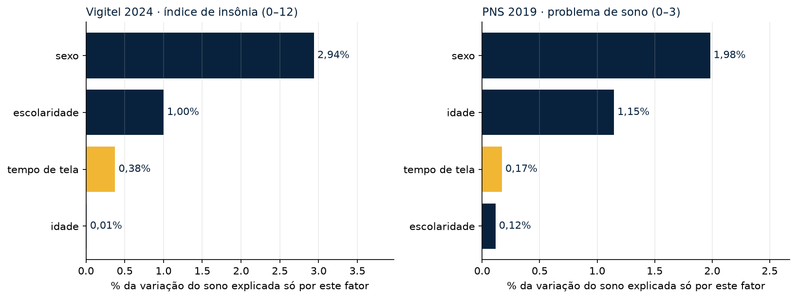
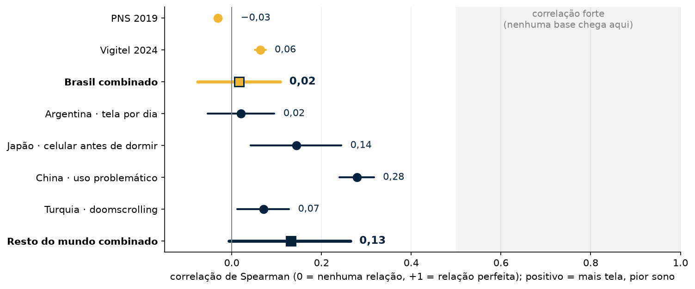

<!-- Arquivo GERADO por analise/relatorio/relatorio.py a partir de docs/modelos/relatorio.md. Edite o modelo, não este arquivo. -->

# Insônia digital: uso de telas e sono no Brasil e em outros quatro países

Estatística 4 · ESEG · Relatório gerado em 27/11/2026 por `analise/relatorio/relatorio.py`. Todos os resultados próprios deste texto (estimativas, IC, p, n) saem de arquivos em `resultados/` e `analise/dados/logs/`, lidos pelo script; nenhum foi digitado à mão. Números da literatura vêm das fontes citadas. Revisão do grupo pendente.

> **Mudança de escopo em 2026-11-27: os EUA saíram do trabalho.** A única base americana (NHANES 2005-06) é de antes do smartphone, e o tempo de tela daquela época não é comparável com o de 2019–2024. O grupo decidiu retirá-la **depois de ver os resultados** que a incluíam. As hipóteses que dependiam dela foram retiradas, com a numeração original mantida, e o registro está no Histórico de cada spec (001 a 005). A decisão é contada aqui por transparência: uma escolha feita depois de ver os dados merece desconfiança, e quem quiser conferir encontra no histórico do git a versão com os EUA.

## Resumo

- **Pergunta.** No Brasil, adultos que usam mais telas no lazer relatam mais problema de sono? As duas pesquisas nacionais (PNS 2019 e Vigitel 2024) concordam? E onde o Brasil fica frente ao resto do mundo (China, Argentina, Turquia, Japão) e à literatura?
- **Dados.** 120.357 pessoas em seis bases abertas: 115.579 (96,0%) nas duas pesquisas brasileiras e 4.778 em amostras da China, Argentina, Turquia e Japão.
- **A associação aparece nas duas pesquisas.** Quem usa computador, tablet ou celular 3 h ou mais por dia tem prevalência de problema de sono frequente 1,32 vez a de quem usa menos de 1 h no Vigitel e 1,19 vez na PNS. São razões de prevalência ajustadas por idade, sexo e escolaridade (p Holm < 0,001 no Vigitel e < 0,001 na PNS).
- **As duas pesquisas concordam.** Não foi detectada diferença entre elas: a razão entre as duas razões de prevalência é 1,11 (IC 95% 0,96 a 1,28; p Holm 0,750), mesmo com perguntas de sono diferentes.
- **O efeito é pequeno.** A tela explica 0,38% da variação do índice de insônia no Vigitel e 0,17% da do problema de sono na PNS. É menos que o sexo nas duas pesquisas e, na PNS, menos que a idade.
- **A idade confunde.** Sem ajuste, a PNS mostra o contrário: os que mais usam tela relatam menos problema de sono (RP bruta 0,85). Quem mais usa tela é jovem (49% dos adultos de 18 a 29 anos usam 3 h ou mais, contra 6% dos de 60 ou mais), e os jovens relatam menos problema de sono (13% contra 25%). Ajustada, a RP vai a 1,19.
- **O Brasil no mundo.** Combinadas, as duas pesquisas brasileiras dão correlação ρ = 0,016; as quatro bases dos outros países, ρ = 0,131. Não foi detectada diferença (análise exploratória, p = 0,173). Com tempo total de tela, a correlação (ρ = 0,017) fica bem abaixo da meta-análise de referência (r = 0,28); uso problemático (0,178) e celular antes de dormir (0,145) se associam mais.
- **Os dados não permitem dizer que a tela causa insônia.** São transversais, e a literatura descreve também o caminho inverso: quem não dorme pega o celular.

## 1. Pergunta e motivação

"Insônia digital" não é diagnóstico; aqui designa os problemas de sono associados ao uso de telas, sobretudo à noite. A literatura internacional é ampla, mas quase toda em crianças e adolescentes de países de alta renda. No Brasil, os estudos são locais, e os dois grandes inquéritos nacionais (PNS e Vigitel) perguntam sobre tela e sono, mas não foram analisados com essa pergunta.

Três perguntas guiam o trabalho:

1. Nas duas pesquisas nacionais, quem usa mais tela relata mais problema de sono, depois de ajustar por idade, sexo e escolaridade?
2. As duas pesquisas chegam ao mesmo tamanho de associação?
3. Onde o Brasil fica frente a outros países (China, Argentina, Turquia, Japão) e à literatura?

O trabalho foi planejado por especificação antes da execução (`specs/`). Cada etapa registrou hipóteses, testes e critérios antes de rodar. As hipóteses das pesquisas brasileiras foram formuladas depois de uma análise exploratória, e a comparação do Brasil com o resto do mundo foi pedida depois de ver os resultados; o texto diz isso onde elas aparecem.

## 2. O que a literatura já estabelece

- **A associação é consistente.** Em 67 estudos com crianças e adolescentes, 90% acharam associação adversa entre tela e sono (HALE; GUAN, 2015). Usar dispositivo portátil na hora de dormir se associa a sono insuficiente (OR 2,17) (CARTER et al., 2016).
- **O tamanho, medido em minutos, é pequeno.** Cada hora de tela se associa a 3 a 8 minutos a menos de sono, e a tela explica menos de 2% da variação (PRZYBYLSKI, 2019).
- **O momento pesa mais que o total.** Checar redes sociais nos 30 minutos antes de dormir se associa a perturbação do sono independentemente do uso diário (LEVENSON et al., 2017). Cada hora de tela na cama se associa a OR 1,59 para sintomas de insônia (HJETLAND et al., 2025). No Brasil, tela por 2 h ou mais antes de deitar se associou a 17 minutos a mais de latência (CASTRO-SANTOS et al., 2023).
- **Uso problemático pesa mais que uso geral.** Na meta-análise de referência, o uso geral de mídia se correlaciona com pior qualidade de sono (r = 0,28) e o uso problemático, com mais problemas de sono (r = 0,33) (HAN; ZHOU; LIU, 2024).
- **A relação é bidirecional.** Comparando a mesma pessoa em dias diferentes, a única associação consistente é a da tela com o início mais tardio do sono (BOURKE et al., 2026). E o problema de sono também precede o uso de tela, que funciona como passatempo enquanto o sono não vem (BAUDUCCO et al., 2024).

Detalhes e as 52 referências do levantamento: `docs/estado-da-arte.md`.

## 3. Dados

| Base | País | Desenho | n | Sono | Tela |
|---|---|---|---|---|---|
| PNS 2019 | Brasil | inquérito domiciliar nacional (peso, estrato, UPA) | 88.531 | problema de sono nas últimas 2 semanas (item do PHQ-9) | horas de computador/tablet/celular e de TV no lazer |
| Vigitel 2024 | Brasil, 27 capitais | inquérito telefônico (peso) | 27.048 | 3 sintomas de insônia | idem |
| Xuzhou | China | universitários | 2.317 | PSQI | uso problemático de smartphone (SAS-SV) |
| Pérez-Chada | Argentina | adolescentes | 864 | latência (min) | horas de tela por dia e antes de dormir |
| Doomscrolling | Turquia | 18 a 40 anos | 1.216 | PSQI, latência | escala de doomscrolling |
| Okajima | Japão | 18 a 29 anos | 381 | escala de insônia de Atenas (AIS) | celular nas 3 h antes de dormir |

O Brasil responde por 96,0% das pessoas analisadas. As quatro bases dos outros países (4.778 pessoas) são amostras de conveniência de jovens, publicadas em repositórios abertos, sem peso amostral.

Cada base foi **harmonizada** (spec 001):

- os códigos de "não sabe" e "recusou" viraram faltantes;
- as faixas de horas de tela foram cortadas em 1 h e 3 h nas duas pesquisas brasileiras;
- cada variável recebeu um grau de equivalência entre bases (`resultados/001/tabelas/equivalencia.csv`).

Com peso amostral, usavam tela digital 3 h ou mais por dia 22% dos adultos na PNS 2019 e 27% no Vigitel 2024. Relatavam problema de sono em mais da metade dos dias 19% na PNS, e dificuldade para adormecer quase sempre ou sempre 22% no Vigitel.


## 4. Métodos

| Técnica | Etapa | Para quê |
|---|---|---|
| PCA por decomposição em valores singulares (Z = UΣVᵀ) | 002 | resumir os itens de cada escala e ver quantas dimensões existem |
| Análise fatorial (máxima verossimilhança, eixos principais; varimax e oblimin) | 002 | separar a variância comum da específica de cada item |
| Análise paralela de Horn, KMO, Bartlett, α de Cronbach | 002 | decidir o número de fatores e a adequação dos itens (HORN, 1965) |
| Regressão de Poisson com peso e variância por linearização (estrato e UPA) | 003 | razão de prevalências (RP) ajustada nas duas pesquisas |
| Regressão linear múltipla, ANOVA, teste t de Welch | 005 | formato da disciplina; Excel e script |
| Decomposição do R² (quanto o R² cai quando cada fator sai do modelo) | 006 | comparar o peso da tela com o da idade, do sexo e da escolaridade |
| Correlação de Spearman com z de Fisher; meta-análise de efeitos aleatórios (DerSimonian-Laird e Hartung-Knapp); Q de Cochran e I² | 004 | pôr as seis bases na mesma escala e medir a heterogeneidade (FIELLER; HARTLEY; PEARSON, 1957; DERSIMONIAN; LAIRD, 1986; HIGGINS; THOMPSON, 2002) |

Regras comuns (`specs/constitution.md`):

- **Teste de hipótese.** Cada hipótese tem H0 (não há associação ou não há diferença), H1 bilateral, α = 0,05, uma estatística (z, t, F, χ² ou Q) com seus graus de liberdade e um p-valor. Rejeita-se H0 quando o p, já corrigido, fica abaixo de 0,05.
- **Correção de Holm** dentro de cada família de hipóteses: mantém em no máximo 5% a chance de pelo menos um falso positivo na família. Todo p de decisão aparece também na versão corrigida ("p Holm").
- Todo teste traz estatística, graus de liberdade, p, tamanho de efeito e IC 95%.
- **Desenho amostral.** Nas pesquisas brasileiras, a decisão usa o peso amostral e, na PNS, também estrato e UPA. Os graus de liberdade da PNS seguem a regra única do projeto, UPAs − estratos (7.453 gl); pela regra do `svyglm` do R, que desconta os parâmetros do modelo, nenhuma decisão muda. Testes de várias restrições ao mesmo tempo usam a correção de Korn-Graubard. O Vigitel não divulga estrato nem UPA: a variância usa só o peso.
- Estimativas brutas e ajustadas aparecem lado a lado.

## 5. Resultados

### 5.1 O índice de insônia do Vigitel mede uma coisa só (spec 002)

**Insônia no Vigitel.** As três perguntas de insônia, respondidas de "nunca" a "sempre" (0 a 4), formam uma única dimensão. A análise paralela retém 1 componente, que explica 75% da variância (α de Cronbach = 0,84; KMO = 0,71). A soma dos três itens, de 0 a 12, correlaciona 0,9998 com a primeira componente, o que justifica usar o índice 0–12 nas etapas seguintes.

| Pergunta | Média (0–4) | Carga na PCA | Carga na AF | α sem o item |
|---|---|---|---|---|
| dificuldade para adormecer (`r703`) | 1,46 | 0,83 | 0,71 | 0,82 |
| dificuldade para voltar a dormir (`r704`) | 1,48 | 0,90 | 0,88 | 0,72 |
| acordar cedo demais (`r705`) | 1,51 | 0,87 | 0,79 | 0,77 |

**PHQ-9 na PNS.** O questionário de depressão tem 1 fator (α = 0,86; KMO = 0,90; 48% da variância na primeira componente). Numa solução exploratória de 2 fatores, o item de sono fica com o cansaço (fator somático), separado do humor deprimido.

**Escalas dos outros países:**

- doomscrolling (Turquia) e insônia de Atenas (Japão): unidimensionais;
- uso problemático de smartphone (China), procrastinação do sono (Turquia) e procrastinação do sono (Japão): 2 dimensões. No Japão, a segunda é a dos itens de redação invertida.

Os escores da PCA e da análise fatorial ordenam as pessoas quase igual: correlação de 0,953 a 0,999.



### 5.2 Brasil: tela e sono nas duas pesquisas nacionais (spec 003)

Desfecho: dificuldade para adormecer "quase sempre" ou "sempre" no Vigitel e problema de sono em mais da metade dos dias na PNS. Exposição: tela ≥ 3 h contra < 1 h por dia. Ajuste: faixa etária, sexo e escolaridade.

**Como ler um teste de hipótese.** Na H3.1, H0 diz que a razão de prevalências é 1 (a tela não muda a prevalência de problema de sono). Se H0 fosse verdadeira, a estatística z seguiria a curva da figura, e só 5% das vezes cairia além de ±1,96 (α = 0,05, bilateral). O z observado no Vigitel é 4,51, muito além do limite: p < 0,001, e p Holm < 0,001 depois da correção. Rejeita-se H0.



**Família 1: a associação em cada pesquisa** (H0: RP = 1; α = 0,05 bilateral; Holm por exposição)

| H | Base | Exposição | RP ajustada (IC 95%) | Estatística | p | p Holm | Decisão |
|---|---|---|---|---|---|---|---|
| H3.1 | Vigitel 2024 | tela digital | 1,32 (1,17 a 1,48) | z = 4,51 | < 0,001 | < 0,001 | rejeita H0 |
| H3.2 | PNS 2019 | tela digital | 1,19 (1,10 a 1,28) | t(7.453) = 4,57 | < 0,001 | < 0,001 | rejeita H0 |
| H3.1 | Vigitel 2024 | TV | 1,20 (1,07 a 1,35) | z = 3,09 | 0,002 | 0,006 | rejeita H0 |
| H3.2 | PNS 2019 | TV | 1,13 (1,05 a 1,20) | t(7.453) = 3,41 | < 0,001 | 0,003 | rejeita H0 |


- **Dose-resposta (H3.4).** O teste de tendência nas 3 faixas rejeita H0 em 4 de 4 combinações de pesquisa e exposição. A faixa de 1 a 3 h, porém, fica perto da de < 1 h: o excesso aparece em ≥ 3 h, e a relação não é uma reta.
- **Família 2: as duas pesquisas concordam?** 0 de 5 hipóteses rejeitam H0 depois de Holm.
  - **PNS × Vigitel (H3.9).** H0: as duas RP são iguais. A razão Vigitel ÷ PNS é 1,11 (IC 95% 0,96 a 1,28); z = 1,44, p = 0,150, p Holm 0,750: não rejeita H0. Não foi detectada diferença entre as pesquisas. Isso não prova que sejam iguais: elas usam perguntas de sono diferentes, e o intervalo é largo.
  - **Faixa etária (H3.7)** e **TV × tela digital (H3.8):** não foi detectada diferença (menores p Holm 1,000 e 0,943).

**Confundimento por idade.** Na PNS, a RP bruta da tela digital é 0,85 (0,80 a 0,91): sem ajuste, quem usa mais tela relata *menos* problema de sono. A figura mostra o motivo. Entre os adultos de 18 a 29 anos, 49% usam tela digital 3 h ou mais e 13% relatam problema de sono; aos 60 ou mais, 6% e 25%. A idade anda junto com as duas variáveis, em sentidos opostos. Ajustada por idade, sexo e escolaridade, a RP vai a 1,19 (1,10 a 1,28). No Vigitel a mudança é pequena: 1,28 bruta e 1,32 ajustada.



### 5.3 Regressão linear múltipla, ANOVA e teste t (spec 005)

Mesmo formato do exercício da disciplina (SUMMARY OUTPUT do Excel), com dummies de tela (referência < 1 h) e covariáveis. Em cada hipótese, H0 diz que o coeficiente da tela é zero (ou que as médias das faixas são iguais); α = 0,05 bilateral, com Holm dentro de cada família (R1: H5.1, H5.3 a H5.6; R2: H5.7 e H5.9).

Cada hipótese aparece com duas estatísticas. A **sem peso** é a que o Excel calcula, no formato da aula. A **com peso** usa o desenho amostral e é a que decide no Vigitel. Nas bases de repositório não há desenho, e as duas coincidem.

| H | Base | Teste | Coeficiente com peso (IC 95%) | Sem peso (Excel) | Com peso (decisão) | p | p Holm | Decisão |
|---|---|---|---|---|---|---|---|---|
| H5.1 | Vigitel | t da tela ≥ 3 h; Y = índice de insônia | 0,59 (0,36 a 0,82) | t(27.022) = 9,68 | t(27.028) = 5,11 | < 0,001 | < 0,001 | rejeita H0 |
| H5.3 | Xuzhou | t do SAS-SV; Y = PSQI | 0,09 por ponto (0,07 a 0,10) | t(2.308) = 13,07 | igual (sem desenho amostral) | < 0,001 | < 0,001 | rejeita H0 |
| H5.4 | Argentina | t da tela antes de dormir; Y = latência (min) | −1,32 min por hora (−2,34 a −0,30) | t(686) = −2,54 | igual (sem desenho amostral) | 0,011 | 0,023 | rejeita H0 |
| H5.5 | Turquia | t do doomscrolling; Y = latência (min) | 0,10 min por ponto (0,03 a 0,17) | t(1.213) = 2,81 | igual (sem desenho amostral) | 0,005 | 0,015 | rejeita H0 |
| H5.6 | Japão | t do celular antes de dormir; Y = AIS | 0,85 ponto por hora (0,16 a 1,54) | t(377) = 2,42 | igual (sem desenho amostral) | 0,016 | 0,023 | rejeita H0 |
| H5.7 | Vigitel | ANOVA de um fator, 3 faixas | — | F(2; 27.026) = 34,91 | F(2; 27.027) = 9,61 (Wald) | < 0,001 | < 0,001 | rejeita H0 |
| H5.9 | Vigitel | t de Welch, ≥ 3 h × < 1 h | diferença 0,43 (0,22 a 0,64) | t(15309,2) = 6,89 (Welch) | t(15.774) = 4,00 (média ponderada) | < 0,001 | < 0,001 | rejeita H0 |

H5.2, H5.8, H5.10 e H5.11 usavam o NHANES e foram retiradas com os EUA.

**Pontos de leitura:**

- **Significativo não quer dizer grande.** No Vigitel, a tela acrescenta 0,0038 ao R² e a diferença de médias tem d de Cohen = 0,124. Em Xuzhou, o uso problemático acrescenta 0,068.
- **Dois resultados são frágeis:**
  - Na Argentina, o sinal é o contrário do esperado (mais tela, menos latência) e some quando a série escolar substitui a idade (p = 0,093).
  - Na Turquia, a associação some sem as observações influentes (p = 0,096).
- **Conferência dos p-valores.** A ferramenta Análise de Dados do Excel foi executada de verdade, por automação. Cada número (coeficiente, erro padrão, t, p, F, R²) foi comparado por três caminhos: saída do Excel, fórmula no Excel e script. Foram 612 comparações: 611 dentro da tolerância (diferença relativa < 1e-8) e 1 exceções documentadas. Entre fórmula e script, a maior diferença relativa foi 4,5e-10, e entre Excel e script, 4,5e-10. A exceção (diferença 4,5e-07) vem do teste t de Welch: o Excel arredonda o grau de liberdade para inteiro, e o relatório usa o fracionário.

**Quanto a tela explica do sono.** A decomposição do R² mede quanto o R² da regressão ponderada cai quando cada fator sai do modelo (a parte que só ele explica).

| Fator | Vigitel 2024 (índice de insônia 0–12) | PNS 2019 (problema de sono 0–3) |
|---|---|---|
| tempo de tela | 0,38% | 0,17% |
| idade | 0,01% | 1,15% |
| sexo | 2,94% | 1,98% |
| escolaridade | 1,00% | 0,12% |
| modelo completo (R²) | 4,2% | 3,9% |

A tela explica pouco: menos que o sexo nas duas pesquisas e, na PNS, menos que a idade. O modelo inteiro explica 4,2% da variação do sono no Vigitel e 3,9% na PNS: quase tudo o que faz alguém dormir mal está fora destas quatro variáveis.




### 5.4 O Brasil no mundo (spec 004)

Correlação de Spearman entre exposição e escore de sono em cada base (positivo = mais tela, pior sono):

| Base | Tipo de exposição | ρ (IC 95%) |
|---|---|---|
| PNS 2019 | tempo total | −0,031 (−0,038 a −0,024) |
| Vigitel 2024 | tempo total | 0,063 (0,051 a 0,076) |
| Argentina | tempo total | 0,021 (−0,054 a 0,095) |
| Japão | celular antes de dormir | 0,145 (0,042 a 0,244) |
| China (Xuzhou) | uso problemático | 0,279 (0,240 a 0,317) |
| Turquia | uso problemático (doomscrolling) | 0,070 (0,013 a 0,128) |

Meta-análise de efeitos aleatórios das 6 bases. O IC de DerSimonian-Laird usa a distribuição normal; o de Hartung-Knapp reescala o erro padrão pela dispersão entre as bases e usa t com k − 1 gl, o que é mais honesto com tão poucas bases.

- **Estimativa global:** ρ = 0,090. Pelo IC de DerSimonian-Laird (0,015 a 0,165; p = 0,019) fica acima de zero; pelo de Hartung-Knapp (−0,029 a 0,207; p = 0,108) não se distingue de zero.
- **H4.1, heterogeneidade** (H0: a associação é igual em todas as bases): Q = 375,9, gl = 5, p < 0,001, p Holm < 0,001; I² = 98,7%. Decisão: rejeita H0; a associação varia muito de uma base para outra.
- **H4.2, tipo de exposição** (H0: sem diferença entre tempo total, pré-sono e uso problemático): a ordem é a da literatura, tempo total 0,017 < pré-sono 0,145 < uso problemático 0,178. Q = 4,81, p = 0,090, p Holm 0,270: não rejeita H0, com só 1 a 3 bases por subgrupo.
- **H4.3, Brasil × outros países com tempo total:** o Brasil (PNS + Vigitel) tem ρ = 0,016 e o outro lado, só a Argentina (adolescentes), 0,021. z = −0,08, p Holm 1,000: não rejeita H0. O teste compara o Brasil com uma única base.
- **H4.4, comparação com a meta-análise de referência** (H0: o ρ de tempo total está fora do intervalo 0,21–0,35 de Han, Zhou e Liu, 2024): o tempo total combinado (0,017) fica abaixo do intervalo, e o teste de equivalência não rejeita H0 (p Holm 1,000). Nos nossos dados, a associação com tempo total é muito menor que a da literatura.

**Brasil × resto do mundo (exploratório).** Pedida pelo grupo depois de ver os resultados e fora da família de Holm, esta comparação junta as duas pesquisas brasileiras de um lado e as quatro bases dos outros países do outro, misturando os tipos de exposição.

| Grupo | k | ρ | IC 95% DerSimonian-Laird | IC 95% Hartung-Knapp |
|---|---|---|---|---|
| Brasil (PNS + Vigitel) | 2 | 0,016 | −0,077 a 0,108 | — (k = 2: 1 gl) |
| Resto do mundo (Argentina, Japão, China, Turquia) | 4 | 0,131 | −0,007 a 0,265 | −0,055 a 0,308 |

A diferença, na escala z de Fisher, é −0,116 (IC 95% −0,283 a 0,051); z = −1,36, p = 0,173. Não foi detectada diferença. O resto do mundo fica mais alto porque reúne as escalas de uso problemático e de celular antes de dormir; com tempo total, a Argentina (0,021) fica perto do Brasil.



- **Desenho amostral (deff):** as correlações das pesquisas brasileiras foram calculadas sem o desenho amostral. Multiplicando a variância pelo deff de Kish (PNS 3,21, Vigitel 3,74), a estimativa global fica 0,091 (−0,004 a 0,185) e o I², 97,9%. Nenhuma decisão muda.
- **Ajuste por idade:** a PNS passa de −0,031 para 0,027 (0,021 a 0,034); o Brasil combinado, de 0,016 para 0,047 (0,008 a 0,086); e o tempo total combinado, de 0,017 para 0,043 (0,007 a 0,078).


## 6. Discussão

**Tamanho.** A associação entre tela e problema de sono aparece nas duas pesquisas brasileiras e na maioria das bases, mas é pequena. Com dezenas de milhares de entrevistados, as pesquisas detectam com folga associações sem importância prática. Esse é o padrão descrito por Przybylski (2019): associações consistentes, que explicam poucos por cento da variação. As razões de prevalência entre 1,19 e 1,32 descrevem um grupo extremo (≥ 3 h) contra o de baixo uso. Na decomposição do R², a tela explica menos da variação do sono que o sexo, e na PNS menos que a idade.

**As duas pesquisas concordam.** PNS e Vigitel usam perguntas de sono diferentes, cobrem populações diferentes (o país todo e as capitais) e foram feitas com cinco anos de distância. Mesmo assim, não foi detectada diferença entre as razões de prevalência (IC da razão 0,96 a 1,28). Ausência de diferença detectada não é prova de igualdade, mas a concordância dá mais confiança de que a associação não é artefato de uma pesquisa só.

**O Brasil no mundo e na literatura.** A correlação brasileira com tempo total (0,016) é parecida com a da Argentina e fica muito abaixo do r = 0,28 de Han, Zhou e Liu (2024). Parte da distância vem da medida: nas pesquisas, a exposição é em faixas de horas e o sono é um item só, o que atenua a correlação. Parte vem da população: a literatura é quase toda de crianças, adolescentes e universitários, e as pesquisas brasileiras cobrem adultos de todas as idades.

**O que importa é o tipo de uso.** As maiores correlações vieram do uso problemático (China) e do celular nas horas antes de dormir (Japão), não do tempo total. Isso concorda com Han, Zhou e Liu (2024), com Levenson et al. (2017) e com Hjetland et al. (2025). Mas cada subgrupo tem uma a três bases, e o teste não confirma a diferença.

**Confundimento.** A inversão do sinal na PNS mostra que a idade confunde a relação: jovens usam mais tela e relatam menos problema de sono. Uma comparação sem ajuste chegaria à conclusão oposta.

**Por que os EUA saíram.** A única base dos EUA (NHANES 2005-06) media computador e videogame antes do smartphone. Comparar Brasil 2019–2024 com EUA 2005 misturaria país e época, e nenhuma conclusão sobre "o Brasil frente aos EUA" seria separável da mudança tecnológica. O grupo retirou a base em 2026-11-27, depois de ver os resultados; isso fica registrado nas specs e nesta seção.

## 7. Limitações

- **Dados transversais.** Não dá para separar "tela piora o sono" de "quem dorme mal usa mais tela" (BAUDUCCO et al., 2024).
- **Mudança de escopo depois dos resultados.** A retirada dos EUA e a comparação Brasil × resto do mundo foram decididas depois de ver os números. A primeira está justificada pela época da base; a segunda é exploratória e fica fora da correção de Holm.
- **O item de sono da PNS é outro.** É o do PHQ-9 (inclui dormir demais), enquanto o Vigitel pergunta sobre dificuldade para adormecer. A comparação PNS × Vigitel (H3.9) mistura pesquisa e item.
- **O Vigitel cobre só as capitais** e não divulga estrato e UPA: a variância usa só o peso.
- **Medidas autorrelatadas e em faixas.** Isso atenua as correlações.
- **Comparação internacional limitada.** As quatro bases dos outros países são amostras de conveniência de jovens, com escalas diferentes. Em H4.3, o lado "outros países com tempo total" tem uma base só (Argentina, adolescentes), e a heterogeneidade é extrema (I² = 98,7%).
- **Bases de repositório sem desenho amostral.**
  - Sexo sem rótulo em Xuzhou e no Japão.
  - Rótulo da escala da Turquia inferido, sem dicionário.
  - 163 adolescentes argentinos sem idade.
- **Renda não entrou** nos modelos (ausente no Vigitel e não harmonizada na PNS).

## 8. Conclusões

1. Em adultos brasileiros, usar tela digital no lazer 3 h ou mais por dia se associa a uma prevalência de problema de sono 19% a 32% maior, depois de ajustar por idade, sexo e escolaridade.
2. As duas pesquisas nacionais concordam: não foi detectada diferença entre a PNS 2019 e o Vigitel 2024 (razão 1,11, IC 95% 0,96 a 1,28).
3. O efeito é pequeno. A tela explica 0,38% da variação do índice de insônia no Vigitel e 0,17% na PNS: menos que o sexo nas duas pesquisas e, na PNS, menos que a idade.
4. Sem ajuste por idade, a conclusão se inverte na PNS. Comparações entre grupos de uso de tela precisam sempre de ajuste.
5. Frente ao resto do mundo, não foi detectada diferença (Brasil ρ = 0,016, outros quatro países ρ = 0,131; exploratório). Com tempo total, o Brasil fica bem abaixo da literatura (r = 0,28). Uso problemático e uso antes de dormir se associam mais ao sono, como diz a literatura, mas com tão poucas bases a diferença não foi confirmada.
6. Os dados são transversais. O resultado é uma associação; mostrar causa exigiria estudo longitudinal ou experimental.

## 9. Como conferir

```bash
export STAT4_BRUTOS=/caminho/para/pesquisa/dados
python -m analise.rodar_tudo
python -m pytest
```

Cada etapa tem:

- uma spec com as hipóteses (`specs/00N-*/spec.md`) e, no Histórico, a retirada dos EUA;
- um notebook executado (`analise/notebooks/`);
- um resumo (`resultados/00N/RESUMO.md`);
- uma explicação didática (`docs/explicacoes/`).

As figuras-síntese da apresentação (teste desenhado, decomposição do R², confundimento por idade, Brasil no mundo) ficam em `resultados/006/` e são geradas por `python -m analise.relatorio.figuras_apresentacao`.

## Referências

BAUDUCCO, S. et al. A bidirectional model of sleep and technology use: A theoretical review of How much, for whom, and which mechanisms. **Sleep Medicine Reviews**, v. 76, p. 101933, 2024. DOI: https://doi.org/10.1016/j.smrv.2024.101933.

BOURKE, M. et al. Within-Person Association Between Daily Screen Use and Sleep in Youth: A Systematic Review and Meta-Analysis. **JAMA Pediatrics**, v. 180, n. 5, p. 500, 2026. DOI: https://doi.org/10.1001/jamapediatrics.2025.6490.

CARTER, B. et al. Association Between Portable Screen-Based Media Device Access or Use and Sleep Outcomes: A Systematic Review and Meta-analysis. **JAMA Pediatrics**, v. 170, n. 12, p. 1202, 2016. DOI: https://doi.org/10.1001/jamapediatrics.2016.2341.

CASTRO-SANTOS, L. et al. Sleep and circadian hygiene practices association with sleep quality among Brazilian adults. **Sleep Medicine: X**, v. 6, p. 100088, 2023. DOI: https://doi.org/10.1016/j.sleepx.2023.100088.

DERSIMONIAN, R.; LAIRD, N. Meta-analysis in clinical trials. **Controlled Clinical Trials**, v. 7, n. 3, p. 177-188, 1986. DOI: https://doi.org/10.1016/0197-2456(86)90046-2.

FIELLER, E. C.; HARTLEY, H. O.; PEARSON, E. S. Tests for rank correlation coefficients. I. **Biometrika**, v. 44, n. 3-4, p. 470-481, 1957. DOI: https://doi.org/10.1093/biomet/44.3-4.470.

HALE, L.; GUAN, S. Screen time and sleep among school-aged children and adolescents: A systematic literature review. **Sleep Medicine Reviews**, v. 21, p. 50-58, 2015. DOI: https://doi.org/10.1016/j.smrv.2014.07.007.

HAN, X.; ZHOU, E.; LIU, D. Electronic Media Use and Sleep Quality: Updated Systematic Review and Meta-Analysis. **Journal of Medical Internet Research**, v. 26, p. e48356, 2024. DOI: https://doi.org/10.2196/48356.

HIGGINS, J. P. T.; THOMPSON, S. G. Quantifying heterogeneity in a meta-analysis. **Statistics in Medicine**, v. 21, n. 11, p. 1539-1558, 2002. DOI: https://doi.org/10.1002/sim.1186.

HJETLAND, G. J. et al. How and when screens are used: comparing different screen activities and sleep in Norwegian university students. **Frontiers in Psychiatry**, v. 16, 1548273, 2025. DOI: https://doi.org/10.3389/fpsyt.2025.1548273.

HORN, J. L. A rationale and test for the number of factors in factor analysis. **Psychometrika**, v. 30, n. 2, p. 179-185, 1965. DOI: https://doi.org/10.1007/BF02289447.

LEVENSON, J. C. et al. Social Media Use Before Bed and Sleep Disturbance Among Young Adults in the United States: A Nationally Representative Study. **Sleep**, v. 40, n. 9, zsx113, 2017. DOI: https://doi.org/10.1093/sleep/zsx113.

PRZYBYLSKI, A. K. Digital Screen Time and Pediatric Sleep: Evidence from a Preregistered Cohort Study. **The Journal of Pediatrics**, v. 205, p. 218-223.e1, 2019. DOI: https://doi.org/10.1016/j.jpeds.2018.09.054.
