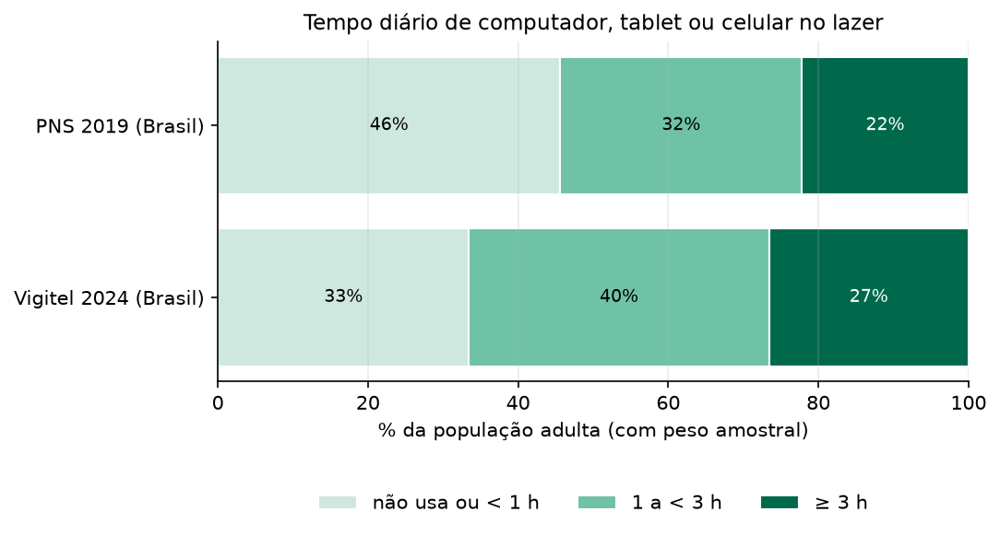
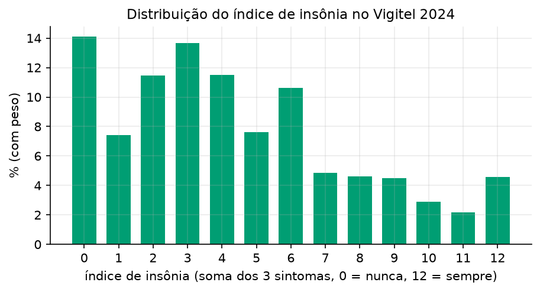

# 001 — Resumo dos dados harmonizados

Gerado por `analise/harmonizacao/figuras.py` a partir de `resultados/001/tabelas/`.

## n final por base

| Base | n |
|---|---|
| PNS 2019 (Brasil) | 88.531 |
| Vigitel 2024 (Brasil) | 27.048 |
| Xuzhou (China) | 2.317 |
| Pérez-Chada (Argentina) | 864 |
| Doomscrolling (Turquia) | 1.216 |
| Okajima (Japão) | 381 |

## Exposição e desfechos nos inquéritos (% com peso amostral)

| Base | Variável | Categoria | n | % sem peso | % com peso |
|---|---|---|---|---|---|
| PNS 2019 (Brasil) | `tela_digital_cat` | não usa ou < 1 h | 45.716 | 51,6 | 45,6 |
| PNS 2019 (Brasil) | `tela_digital_cat` | 1 a < 3 h | 26.006 | 29,4 | 32,2 |
| PNS 2019 (Brasil) | `tela_digital_cat` | ≥ 3 h | 16.809 | 19,0 | 22,2 |
| PNS 2019 (Brasil) | `tela_tv_cat` | não usa ou < 1 h | 26.072 | 29,4 | 29,3 |
| PNS 2019 (Brasil) | `tela_tv_cat` | 1 a < 3 h | 43.210 | 48,8 | 48,9 |
| PNS 2019 (Brasil) | `tela_tv_cat` | ≥ 3 h | 19.249 | 21,7 | 21,8 |
| PNS 2019 (Brasil) | `problema_sono_freq` | sim | 16.491 | 18,6 | 18,6 |
| Vigitel 2024 (Brasil) | `tela_digital_cat` | não usa ou < 1 h | 8.874 | 32,8 | 33,5 |
| Vigitel 2024 (Brasil) | `tela_digital_cat` | 1 a < 3 h | 11.254 | 41,6 | 40,0 |
| Vigitel 2024 (Brasil) | `tela_digital_cat` | ≥ 3 h | 6.901 | 25,5 | 26,6 |
| Vigitel 2024 (Brasil) | `tela_tv_cat` | não usa ou < 1 h | 10.318 | 38,1 | 34,9 |
| Vigitel 2024 (Brasil) | `tela_tv_cat` | 1 a < 3 h | 11.940 | 44,1 | 44,4 |
| Vigitel 2024 (Brasil) | `tela_tv_cat` | ≥ 3 h | 4.790 | 17,7 | 20,8 |
| Vigitel 2024 (Brasil) | `dif_adormecer_freq` | sim | 6.092 | 22,5 | 22,0 |

Equivalência de cada variável entre as bases: `resultados/001/tabelas/equivalencia.csv`. Descritiva completa (média, DP, mínimo, máximo): `resultados/001/tabelas/descritiva.csv`.
